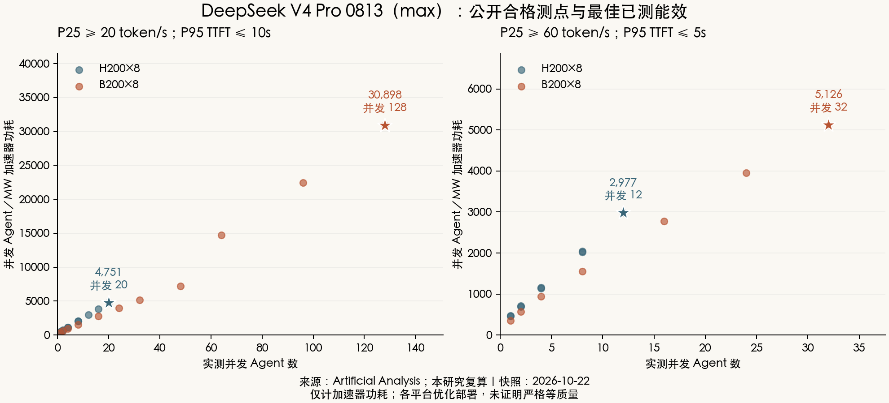
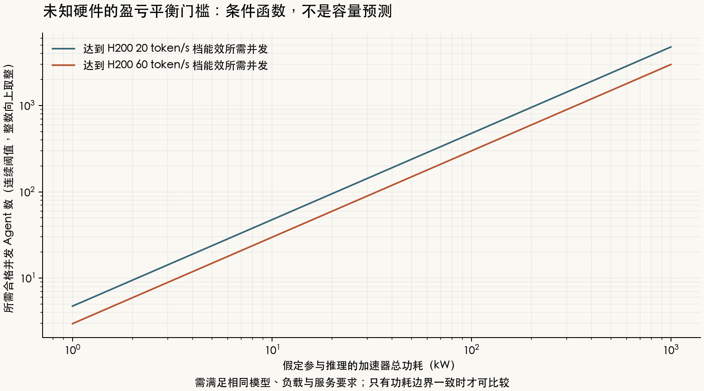

# 昇腾与 NVIDIA：DeepSeek V4 Pro 并发 Agent／MW 能效研究

资料截止：**2026-10-22**。主模型为 **DeepSeek V4 Pro 0813（max）**；模型规格取官方 revision `72e1d3230f6c080a530b0a1d46f8eb4602340597`。本研究采集和复算公开证据，没有自行运行这些硬件。`max` 是推理档位，不是另一套名为“Pro Max”的权重。

## 可以回答到什么程度

**在已公开且满足本研究服务要求的测点中，H200×8 与 B200×8 可以算出并发 Agent／MW；昇腾各系列和 H100 尚缺同模型、同轨迹、并发与功耗齐全的公开结果，因此不能给出可信的完整实测排名。** 能部署、峰值算力高、或单卡吞吐高，都不能单独补上这个缺口。

| 硬件／系统 | P25 ≥20 token/s，P95 TTFT ≤10s | P25 ≥60 token/s，P95 TTFT ≤5s | 证据状态 |
|---|---:|---:|---|
| 昇腾910原版 | — | — | 无同口径实测；当前软件部署也未闭合 |
| 昇腾910B家族 | — | — | A2有部署指南；逐bin与运行功耗不齐 |
| 昇腾910C／A3 | — | — | 有0813部署证据，无完整AgentPerf负载功耗曲线 |
| 昇腾950PR | — | — | 有产品与模型适配，缺同口径负载实测 |
| 昇腾950DT | — | — | 有商用系统与模型适配，缺同口径负载实测 |
| NVIDIA H100 | — | — | 0813可部署；此次AA快照无该模型测点 |
| NVIDIA H200×8 | **4,751** | **2,977** | 公开优化实测点中的最佳能效 |
| NVIDIA B200×8 | **30,898** | **5,126** | 公开优化实测点中的最佳能效 |

单位均为并发 Agent／MW 加速器功耗；`—` 表示证据不足，不是零容量。数值取整，完整值见[复算结果](generated-results/research-calculation-results.json)。按这组公开优化部署，B200/H200比值分别为 **6.50×、1.72×**；不能解释为固定的纯芯片代际倍数，也不能外推成昇腾相对倍数。[AA公开数据](https://artificialanalysis.ai/hardware-inference-stack/datacenter)



最有价值的产品更新是：**950已不能整体归为“待推出”。** 2026年9月的官方资料确认液冷与风冷950超节点上市，并称Atlas950规模商用；当前产品页最多支持 **1024颗950DT、每颗96GB**。2025年规划中的 **8192颗、144GB** 是另一时点与配置，不能替代现行产品规格，也不据产品上限推定每笔实际交付配置。[上市说明](https://www.hiascend.com/activities/dynamic-news/783)、[现行Atlas950](https://www.hiascend.com/hardware/cluster)

## 指标定义与实测结果

### “相同setting”如何执行

本研究分为两组：

- **严格匹配组**要求同checkpoint与effort、量化及KV格式、轨迹及长度分布、缓存策略和服务要求；各平台原生后端的差异仍需披露。目前没有足够证据建立昇腾与NVIDIA的这一组实测排名。H200与B200现有配置的KV、缓存层级与服务栈也未形成完整控制组。
- **平台优化组**保留各平台实际使用的量化、投机解码、缓存和并行配置，展示公开测量。现有AA结果属于本组；缺少逐运行端到端质量等价验证，所以不把它们纳入“严格等质量”的排名。

两档服务约束分别为 `P25(output speed) ≥20/60 token/s` 与 `P95(TTFT) ≤10/5s`。这是本研究沿用的响应要求，**新版AA方法页已改为吞吐—速度前沿，不再声明旧固定档位**。P25是请求级分位数，约四分之三请求达到该速度，不保证每一个Agent的每一步都达标；速度排除首token等待。工具等待采用轨迹模拟，也不代表真实工具执行基础设施的服务容量。[当前方法](https://artificialanalysis.ai/methodology/agentperf)

核心计算为：

\[
E_i=\frac{10^6 C_i}{P_i[\mathrm{W}]},\qquad
E^*_{h,s}=\max_{i\in\text{硬件 }h\text{ 的公开测点},\;P25_i\ge s,\;P95TTFT_i\le t_s}E_i
\]

`C`是活跃Agent会话数；`P`是**同一测点全部参与加速器的平均总功耗**。`powerAvgTotalW`已是总瓦数，不能再乘8。功耗边界为加速器die＋HBM，排除CPU、主机DRAM、网络、存储、供电损耗和制冷。MW是功率单位和容量归一化，不是电量，也不是验证过实际1MW集群的扩展结果。

Agent会话包含推理、工具等待和上下文复用，不等同于同时解码的请求。AA总吞吐还含缓存命中的输入token，不能拿它除以20或60得到Agent并发。[指标口径](https://artificialanalysis.ai/methodology/agentperf)

### 四个最佳测点

| 系统／档位 | 并发Agent | P25输出 token/s | P95 TTFT 秒 | 加速器实测总功耗 W | Agent／MW | 原页面points索引 |
|---|---:|---:|---:|---:|---:|---:|
| H200×8／20 | 20 | 37.2114 | 2.3945 | 4,209.3723 | 4,751.3022 | 340 |
| H200×8／60 | 12 | 60.1646 | 1.8192 | 4,030.3683 | 2,977.3954 | 342 |
| B200×8／20 | 128 | 22.4604 | 3.7636 | 4,142.6236 | 30,898.2932 | 394 |
| B200×8／60 | 32 | 67.7997 | 1.0105 | 6,242.1732 | 5,126.4198 | 397 |

H200测量在2026-09-18～19，B200在2026-10-08；快照采于2026-10-22。H200共11点、2个配置；B200共14点、3个配置。20档分别有11／11个合格点，60档有9／7个合格点。以上四行同时也是各组最大已测合格并发，但脚本分别计算两者，允许未来最优能效与最大并发来自不同点。固定并发采样没有证明真实容量上限；没有重复实验或置信区间，H200的60档点仅略高于速度门槛，结果的稳健性仍需复测。

逐点数值、运行时间、配置ID和响应SHA256见[25个标准化测点](generated-results/normalized-public-agentperf-measured-points.csv)，原记录见[当前冻结快照](source-evidence/artificial-analysis-agentperf-deepseek-v4-pro-0813-current-snapshot.json)。索引仅定位本次响应，不是AA原生运行ID；需连同响应hash使用。

### 配置差异如何影响解释

| 最佳点所用配置 | 配置ID | 已公开设置 | 尚未闭合的比较条件 |
|---|---|---|---|
| H200，两档 | `17db15bd-d740-4987-81f1-bbd0cf936e95` | SGLang0.5.19，MXFP4，TP8，DSpark块6；静态显存比例0.88，prefill chunk4096，最多32运行请求 | 启动命令未显式给KV dtype与最大上下文，不能推断 |
| B200，20档 | `b80a56d5-d2d9-4ded-90fb-a0e1a37fe5a6` | SGLang0.5.21，MXFP4 MegaMoE，DP8/TP8/EP8，FP4 indexer，DSpark6，主机DRAM HiCache ratio8 | 主机DRAM参与服务，但其电力不计入当前分母 |
| B200，60档 | `18bb5680-e20c-4167-bf4b-ccb9e2de5969` | vLLM0.31.0，TP8，FP8 KV、MXFP4 indexer，DSpark7 | 与20档不是同一软件和缓存配置 |

五个配置的命令注释均声明同一官方0813 revision，但本研究没有独立校验每次运行实际加载的权重内容。完整命令和元数据已保存于[配置证据](source-evidence/artificial-analysis-agentperf-configuration-details-snapshot.json)，来源为[AA配置浏览器](https://artificialanalysis.ai/hardware-inference-stack/configs?model=deepseek-v4-pro)。**6.50×尤其包含缓存、并行与软件优化效果；用本表不能判断整机或机房能效倍数。**

### 原始2594／1786示例已复现

| 旧模型／系统 | 服务要求 | 搜索最大通过并发／首个失败并发 | 实测加速器总功耗 | 复算Agent／MW |
|---|---|---:|---:|---:|
| V4 Pro 0424（Max），H200×8 | 20 token/s＋TTFT≤10s | 11／12 | 4.24kW | 2,594.3396 |
| 同上 | 60 token/s＋TTFT≤5s | 7／8 | 3.92kW | 1,785.7143 |

旧测量日期为2026-06-11，配置为SGLang `0.5.11 DSv4`、MXFP4、TP8、EAGLE。两档分母不同，不能统一替换成 `8×700W`。旧模型、投机算法和容量搜索方法均不同，不把新版数字相对旧数字的变化归因于硬件提升。[首发来源](https://artificialanalysis.ai/articles/aa-agentperf/)、[历史复算表](generated-results/historical-h200-reference-recalculation.csv)

## 产品规格、商业状态与部署证据

### 昇腾：同系列必须分具体产品

| 产品／证据范围 | 截止日状态 | HBM与带宽 | 可核验功率 | 对本研究的用途 |
|---|---|---|---|---|
| 910原版 | 历史已发布，当前在售SKU未核实 | 架构文章HBM总带宽1.2TB/s；板卡容量未闭合 | 架构文章TDP300W；2019年报达到所述算力时310W | 分别保留不同口径，不能套用于910B/C |
| 910B1/B2/B2C/B3/B4/B4-1 | 官方代码可识别；家族有实际部署，逐bin状态未知 | 各bin映射留空 | 各bin功耗留空 | 不拼接不同后缀的规格 |
| Atlas300I A2物理推理卡 | 官方产品可查，精确910B后缀未披露 | 32GB/0.8TB/s或64GB/1.6TB/s | 整卡最大350W | 不等同全部A2服务器卡 |
| 910C，CloudMatrix论文v2配置 | 系统已商用，精确bin未披露 | 每封装128GB、3.2TB/s；每die一半 | 未找到同配置负载功耗 | 固定论文版本的结构证据 |
| Atlas800I A3 | 产品及0813部署可查 | 每节点8封装×128GB | 此次未闭合负载实测功耗 | 有模型适配，非容量证明 |
| 950PR芯片家族 | 有现行产品及商用平台 | 128GB/1.6TB/s或112GB/1.4TB/s | 依具体卡／模组确定 | 主要面向Prefill／推荐 |
| Atlas350，950PR PCIe卡 | 现行官方产品 | **112GB、1.4TB/s** | 整卡最大**≤600W** | 不能套用家族128GB上限 |
| 950DT芯片家族 | 已有上市系统；144GB bin独立交付未核实 | 144GB或96GB，4TB/s | 依具体模组确定 | 主要面向Decode／训练 |
| 现行Atlas950液冷系统 | 官方称已上市、规模商用 | 最多**1024封装×96GB**本地HBM | 该系统NPU模组**950W规格** | 不代表die＋HBM负载实测 |

来源与适用范围：[华为2019年报](https://www-file.huawei.com/-/media/corporate/pdf/annual-report/annual_report_2019_cn.pdf?la=zh)、[原版架构文章物理第113～114页](https://www-file.huawei.com/admin/asset/v1/pro/view/6ca306adab0a4852bacffce25f5573ec.pdf)、[官方SoC识别代码](https://gitee.com/ascend/RecSDK/blob/8251e16519db9132e33d33685d9d7a50607e1567/src/lccl/src/lcal_comm.cpp?skip_mobile=true)、[Atlas300I A2](https://e.huawei.com/cn/products/computing/ascend/atlas-300i-a2)、[CloudMatrix论文v2](https://arxiv.org/html/2506.12708v2)、[Atlas800I A3](https://e.huawei.com/cn/products/computing/ascend/atlas-800i-a3)、[950架构白皮书](https://public-download.obs.cn-east-2.myhuaweicloud.com/ascend/%E6%98%87%E8%85%BE950%20NPU%E6%9E%B6%E6%9E%84%E7%99%BD%E7%9A%AE%E4%B9%A6.pdf)、[Atlas350](https://www.hiascend.com/hardware/accelerator-card)、[现行Atlas950](https://www.hiascend.com/hardware/cluster)。逐项来源ID、页码、访问日期和缺项见[产品证据JSON](hardware-product-and-deployment-evidence.json)。

950白皮书的封装含2个AI Die与2个IO Die，不能算成4张卡。其2016GB/s是芯片UB双向峰值，且端口与PCIe/UBoE复用；Atlas350实际引出带宽依拓扑为318或424GB/s双向，不能把芯片上限填进物理板卡表。Atlas950的256TB统一编址空间也不等于256TB本地HBM，产品列出的本地HBM是1024×96GB。[白皮书物理第12～15页](https://public-download.obs.cn-east-2.myhuaweicloud.com/ascend/%E6%98%87%E8%85%BE950%20NPU%E6%9E%B6%E6%9E%84%E7%99%BD%E7%9A%AE%E4%B9%A6.pdf)

还有一个会造成两倍误差的计数问题：A3的8个物理封装可对应16个运行时die设备。vLLM部署表的“4节点64 NPUs”与“每节点8×128GB”并不矛盾；不能据前者计算 `64×128GB`，也不能用逻辑world size重复乘模组功耗。论文v2包含910C的具体规格，v3删去部分细节，引用时保留版本。[A3部署指南](https://docs.vllm.ai/projects/ascend/en/main/tutorials/models/DeepSeek-V4-Pro.html)

### NVIDIA：SXM、PCIe和GB200分开

| 指定产品 | 每GPU HBM | 带宽 TB/s | 逐GPU NVLink聚合 GB/s | GPU最大可配置功率 | DGX完整节点最大功率 |
|---|---:|---:|---:|---:|---:|
| H100 SXM | 80GB | 3.35 | 900 | 700W | 10.2kW |
| H200 SXM | 141GB | 4.8 | 900 | 700W | 10.2kW |
| B200 HGX/DGX | 180GB | 8.0 | 1800 | 1000W | 14.3kW |

三者均已商业可用。表中是产品规格，不是上面Agent负载的实测功率；完整节点还含主机等组件。B200是双die组成的一个GPU，8个B200仍是8个GPU。官方泛化目录有192GB B200写法，本研究采用指定HGX/DGX资料的180GB；GB200另有192GB配置，不推测差值原因。[HGX参考架构](https://docs.nvidia.com/enterprise-reference-architectures/hgx-ai-factory-h100-h200-b200/latest/components.html)、[DGX H100/H200](https://docs.nvidia.com/dgx/dgxh100-user-guide/introduction-to-dgxh100.html)、[DGX B200](https://docs.nvidia.com/dgx/dgxb200-user-guide/introduction-to-dgxb200.html)、[NIM配置表](https://docs.nvidia.com/nim/large-language-models/2.0.6/day-0/support-matrix-day-0.html)

### 已能部署，不等于已验证并发能效

vLLM Ascend列出0813 W4A8在2台128GB×8的A3或4台64GB×8的A2上部署，950PR/DT支持W4A4C8配方；官方SGLang则给出H100双节点TP16与H200/B200单节点TP8配置。这些资料证明有部署路径，没有同时提供本研究所需的Agent轨迹、SLO合格并发与稳态功耗。[Ascend指南](https://docs.vllm.ai/projects/ascend/en/main/tutorials/models/DeepSeek-V4-Pro.html)、[SGLang指南](https://github.com/sgl-project/sglang/blob/main/docs/cookbook/autoregressive/DeepSeek/DeepSeek-V4.mdx)

质量证据也须限定使用：Ascend指南提供GSM8K等分数，但没有完整配对源基线，且GPQA一项备注写“0831”而权重名为0813，保留这一冲突。NVIDIA的0813 NVFP4模型卡有MXFP4→NVFP4配对回归，例如GPQA88.51→88.42、Terminal-Bench Hard51.39→50.69，但其验证未启用DSpark。**AA本次配置标注MXFP4，不能拿另一套NVFP4的质量表给AA运行补证明。**[NVIDIA量化模型卡](https://huggingface.co/nvidia/DeepSeek-V4-Pro-0813-NVFP4)

## 理论量：能算必要条件和达到基准的门槛

### 显存必要条件

固定revision的官方权重索引给出payload **892,727,580,904 B＝892.728 GB＝831.417 GiB**，含草稿等发布内容。约1.6T总参数、49B激活参数只是结构规模；不能按 `1.6T×0.5B` 代替实际索引大小，也不能把激活参数当作全部驻留权重。[官方索引](https://huggingface.co/deepseek-ai/DeepSeek-V4-Pro-0813/resolve/72e1d3230f6c080a530b0a1d46f8eb4602340597/model.safetensors.index.json)

在“发布权重完整单副本驻留、无进一步重编码／裁剪／卸载”的限定下，8个物理封装的聚合字节预算如下。它只检查总容量，不保证分片可放置或满足速度。

| 每封装标称HBM | 8封装合计 GB | 扣除发布payload后 GB | 对本模型的意义 |
|---|---:|---:|---|
| 64GB | 512 | −380.728 | 该假设下权重已放不下 |
| H100，80GB | 640 | −252.728 | 单节点8卡不能全驻留这份payload；可改多节点／卸载／格式 |
| 950DT的96GB变体 | 768 | −124.728 | 不可套用144GB变体的容纳结论 |
| Atlas350，112GB | 896 | 3.272 | 几乎无运行余量，不能据总容量宣称可部署并发 |
| 128GB | 1024 | 131.272 | 仍须扣KV、草稿工作区、复制与保留量 |
| H200，141GB | 1128 | 235.272 | 同上 |
| 950DT的144GB变体 | 1152 | 259.272 | 同上；不证明此bin已交付 |
| B200，180GB | 1440 | 547.272 | 同上；不保证实际服务配置采用此运行布局 |

GB按10⁹字节计算。这不是不同量化格式的通用运行时显存下界；加载重排、反量化、权重复制或卸载都会改变预算。每个设备还必须分别满足：

\[
W_{\mathrm{resident},j}+KV_j(C,L,\mathrm{layout},\mathrm{replicas})+
\mathrm{workspace}_j+\mathrm{reserve}_j\le HBM_{\mathrm{usable},j}
\]

完整表见[字节预算CSV](generated-results/published-checkpoint-aggregate-memory-necessary-conditions.csv)。

### KV缓存不能套普通Dense公式

0813采用共享K=V和压缩注意力；主干61层包含30个CSA层与31个HCA层。对于已核验的特定vLLM缓存布局，单逻辑副本的主干缓存＋indexer结构payload可写为：

\[
M(L)=\big[61\min(L,128)+30\lfloor L/4\rfloor+31\lfloor L/128\rfloor\big]584
+30\lfloor L/4\rfloor b_{index},\quad b_{index}\in\{68,132\}\ \mathrm{B}
\]

FP4 indexer条件下，32K／128K／1M上下文（分别为32,768／131,072／1,048,576 tokens）约 **0.158／0.618／4.918 GiB**。这是单逻辑副本的结构payload，另加分页、压缩尾态、草稿、工作区和物理副本；不能自动除以TP，也不认定为AA或Ascend实际布局。官方参考代码还使用BF16张量模拟低比特缓存，不能凭“FP4”标签推算物理显存。[固定模型配置](https://huggingface.co/deepseek-ai/DeepSeek-V4-Pro-0813/blob/72e1d3230f6c080a530b0a1d46f8eb4602340597/config.json)、[vLLM布局实现](https://github.com/vllm-project/vllm/blob/b965ee564d1897fdaeddaeceecc316aa15a45312/vllm/models/deepseek_v4/attention.py)、[缓存预算CSV](generated-results/conditional-main-cache-and-indexer-payload.csv)

### 计算、HBM和互联约束

可以建立乐观的步骤时间下界：

\[
t_{step}\ge\max\left(
\frac{F_{executed}}{F_{peak,\mathrm{matching\ precision}}},
\frac{B_{HBM}}{BW_{HBM,peak}},
\frac{B_{interconnect}}{BW_{interconnect,peak}}\right)
\]

但本次没有各平台在本轨迹上的执行FLOPs、实际HBM字节和互联消息计数，因此不生成伪精确吞吐预测。49B激活参数不包含全部注意力、压缩、路由、草稿校验与prefill工作，也不能直接换成精确FLOPs。一个batch会共享专家权重；每token激活的专家字节不等于必须从HBM读取的字节。互联还受all-to-all时延、负载不均和P/D传输影响，峰值带宽不能替代实测。

因此，950DT比950PR的HBM带宽更适合某些decode负载，PR/DT分工也有官方部署依据，但**这些结构信息不足以判定在本模型SLO下谁的Agent／MW更高**。[PR/DT架构与异构部署](https://www.hiascend.com/activities/dynamic-news/783)

### 昇腾需要达到多少并发，才与H200等能效

不猜未知平台容量，反过来计算可验证门槛：

\[
C_{equal}(P)=E^*_{H200,s}\frac{P}{10^6},\qquad
C_{integer}=\lceil C_{equal}\rceil
\]

| 假定全部参与加速器总功耗 | 达到H200的20档能效至少需并发 | 达到H200的60档能效至少需并发 |
|---:|---:|---:|
| 7.6kW | 37 | 23 |
| 15.2kW | 73 | 46 |
| 30.4kW | 145 | 91 |
| 60.8kW | 289 | 182 |
| 121.6kW | 578 | 363 |
| 972.8kW | 4,623 | 2,897 |

上表是**条件门槛，不是昇腾能力估计**。7.6kW等数值可以联想到8×950W模组预算，但950W是特定液冷系统模组规格，不是die＋HBM负载实测；它不能直接与AA分母作严格比较。1024×950W＝972.8kW也仅是NPU模组规格合计，未包含CPU、DRAM、互联套片、光模块和供电等，更不是整套SuperPoD总功耗。异构P/D部署必须把两个池的实际功耗一起计入，不能只算decode池。[模组规格来源](https://www.hiascend.com/activities/dynamic-news/783)、[门槛CSV](generated-results/h200-equivalent-energy-efficiency-required-concurrency.csv)



要把任一昇腾条目变为实测结论，需要提供：具体SKU及物理／逻辑设备映射、完整P/D拓扑、固定权重及量化、同轨迹长度和缓存条件、逐并发P25速度与P95 TTFT、同时间窗全部参与加速器的功率，以及有对照的质量结果。完整AA测试集未公开，公开调优子集可用于代理实验，但必须标成代理负载，不能冒称原榜单同口径。[AA测试集说明](https://artificialanalysis.ai/methodology/agentperf)

## 证据、复算与更新

本目录交付的是研究报告、结构化证据和可复算结果。当前快照保存必要JSON及完整关联配置，没有将整页HTML或模型权重入库。

| 文件／目录 | 内容 |
|---|---|
| [产品与部署证据](hardware-product-and-deployment-evidence.json) | 逐产品状态、规格、边界、来源ID及质量证据 |
| [模型与理论证据](model-memory-and-theoretical-analysis-evidence.json) | 固定revision、索引字节数、缓存布局与假设 |
| [AA源证据](source-evidence/) | 最新25点、旧例搜索、完整配置、方法观察及采集器 |
| [来源登记CSV](generated-results/primary-source-evidence-register.csv) | 来源URL、日期、定位及支持范围 |
| [产品矩阵CSV](generated-results/hardware-product-evidence-matrix.csv) | 物理边界、内存、功率及缺项 |
| [计算结果与hash](generated-results/) | 测点、两档汇总、理论预算、门槛与产物SHA256 |
| [PNG与SVG图](figures/) | 实测分布及条件门槛，可独立导出 |

在仓库根执行；计算与验证只需Python标准库，不联网：

```bash
python3 docs/ascend-versus-nvidia-agent-concurrency-per-megawatt-research/recompute_agent_concurrency_energy_efficiency.py
python3 -m unittest discover -s docs/ascend-versus-nvidia-agent-concurrency-per-megawatt-research -p 'test_*.py' -v
```

重新绘图使用隔离依赖，不修改项目依赖；缺少中文字体时可传 `--chinese-font-path`：

```bash
uv run --no-project --with matplotlib==3.10.7 python docs/ascend-versus-nvidia-agent-concurrency-per-megawatt-research/render_agent_energy_efficiency_research_figures.py
```

未来刷新AA证据时，用新建的持久目录保存快照；采集器拒绝覆写本次源文件。显式传入该目录复算到另一目录，不将历史示例与新版数据拼成一条趋势。若模型别名改指其他checkpoint，采集器会停止，须先调整研究对象和相应证据。

自动核验覆盖：2594／1786旧例、W／kW和总功耗边界、速度与TTFT同时筛选、最佳效率与最大并发分开、内部模型身份、测点完整性及功耗覆盖卡数、缺失／非有限值、以及离线产物重复生成的一致性。具体执行结果和交付状态见[验证记录](research-execution-and-validation.md)。
